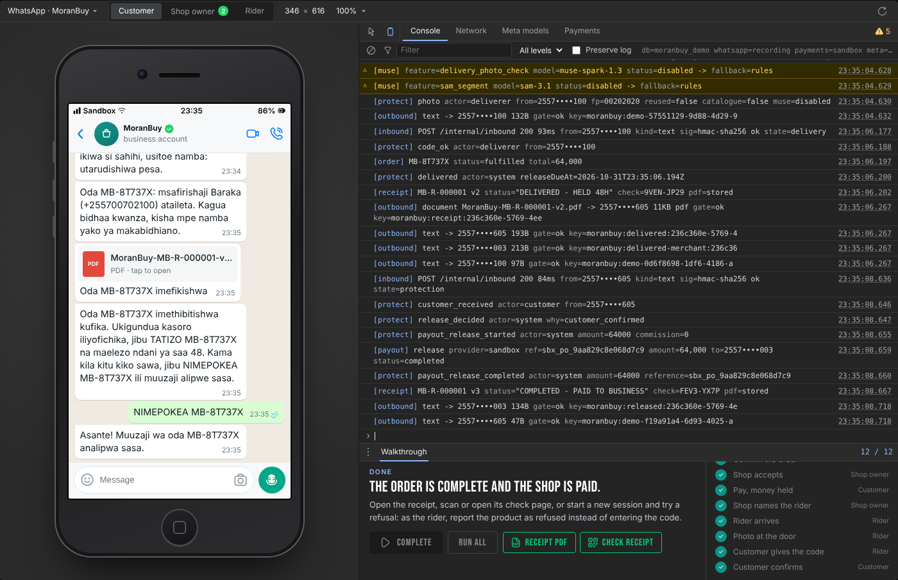

# MoranBuy

**Tell us your budget. The shops come to you.**

MoranBuy is an AI reverse marketplace on WhatsApp. A customer sends one message, a photo or a voice
note: what they need, what they can pay, and where they are. MoranBuy finds the shops that have it,
ranks the offers budget first, and holds the payment until the product is in the customer's hands.
Every model it calls is a Meta model, and it reaches customers where they already are: WhatsApp.

> Build status: complete and tested for customers (WhatsApp, found by the username @moranbuy; text, photos and voice), standalone and
> Moran-registered businesses, and administrators in Moran's Super Admin. Live services (WhatsApp, the Meta
> Model API, Snippe) run once their keys are entered. `HACKATHON_CHANGES.md` lists what is new; the public sandbox at
> [buy.moranai.co.tz/demo](https://buy.moranai.co.tz/demo) runs the real code on the real Meta models.

## For judges: run it in five minutes

Everything below runs from this repository alone, with no Moran AI account and no WhatsApp number. The
sandbox is the real MoranBuy code on a simulated phone (customer, shop owner, rider) next to the live
server log, which prints every call to the Meta Model API as it happens.

```bash
git clone https://github.com/tito-devsec/moranbuy && cd moranbuy
cp .env.example .env            # add MUSE_API_KEY=<your Meta Model API key> for live Meta calls
docker compose up demo          # first build 5-10 min (it exports Meta's MMS voices); then open http://localhost:4001/demo
```

Without Docker, with Postgres 16 (user `moranbuy`, password `moranbuy`, allowed to create databases) and Redis
running locally: `npm ci && npm run demo`, then open http://localhost:4001/demo. `TTS_VOICES= docker compose up demo`
skips the voice export for a quicker first build (spoken replies off).

What to try on the demo page: press **Run all** for the whole story (terms, request, offers, order, payment held,
rider, photo, handover code, shop paid, receipt), or type your own request as the customer, send a product photo with
the camera button, share a location with the pin button, or press the microphone for a Swahili voice note. The
terminal's first lines say `meta model api: live model=muse-spark-1.3` when a key is set, or `no key -> rules fallback`
when not; every Muse call then appears as `[muse] POST api.meta.ai/...` with its latency and tokens.

**Hosted copy, optional:** [buy.moranai.co.tz/demo](https://buy.moranai.co.tz/demo) runs the same code with a live Meta key
already set; no login, no real money, no real numbers (see *Try the demo* below for its limits).

**Which Meta models, and where they run**

| Model | Runs | Used for |
|---|---|---|
| Muse Spark 1.3 (`muse-spark-1.3`) | Meta Model API, `https://api.meta.ai/v1/chat/completions` | Reading requests and photos, writing replies, campaign drafts |
| Muse Spark web search | Meta Model API, `https://api.meta.ai/v1/responses` with the `web_search` tool | Finding products online near the customer |
| Muse Spark 1.2 audio (`muse-spark-1.2`) and Muse Voice Transcribe (`muse-voice-transcribe-1.0`) | Meta Model API | Hearing voice notes |
| Segment Anything 3.1 (`sam-3.1`) | Meta Model API | Finding products in a shop's photo; checking delivery photos |
| MMS text-to-speech (`facebook/mms-tts-swh`, `mms-tts-eng`) | Inside the API container, as ONNX, downloaded from Hugging Face at image build | Spoken replies in Swahili and English |

Model ids and the base URL are in `.env.example`; one key (`MUSE_API_KEY`) covers every hosted model. Tests:
`npm run lint && npm run check && npm test && npm run test:integration` (186 tests, Postgres and Redis needed).

## The problem

In most of the world, buying something still means going to find it. The buyer does not know who has
the product, at what price, or whether it is in stock, so they travel, ask, bargain, and travel again.
The shop with the right product at the right price never hears from the buyer three streets away who
wants it today. And when buying at a distance is possible at all, the buyer has to pay a stranger first
and hope the product arrives.

Three things are missing, and they are the same in Dar es Salaam, Nairobi, Lagos or Dhaka:

1. **Discovery that starts from the buyer.** Shops advertise what they have; nobody asks what buyers want.
2. **Honest comparison.** Prices, delivery costs and distance are never on one screen.
3. **Trust at the handover.** Nothing protects the buyer's money or the seller's product until the two meet.

### Case study: Kariakoo, Dar es Salaam

We built and tested MoranBuy in Tanzania, so Kariakoo is our case study, not our limit. Kariakoo is
the biggest trading hub in East Africa: estimates put the crowd at more than 200,000 people a day
([TRT Afrika](https://www.trtafrika.com/english/article/13305704)) and the money moving through the
area at more than TSh 10 billion a day, with banking estimates of up to TSh 16 billion
([AllAfrica](https://allafrica.com/stories/201203020066.html)). Most of it is cash and mobile money,
paid face to face.

How buying works there today:

- **The buyer travels to find out.** Someone in Mbagala, Kimara or Arusha spends a day and a bus fare
  walking from stall to stall, asking each one the price of the same item and bargaining.
- **Prices are hidden.** The same laptop or sofa has a different price in every shop, and the buyer
  only learns them by asking.
- **Shops wait for walk-ins.** A shop with exactly the right item at the right price never hears from
  the buyer three streets away, or in another region, who wants it right now.
- **Buying remotely is risky.** Paying a seller first over mobile money and receiving nothing, or the
  wrong item, is the common fear that keeps people travelling in person.

## How MoranBuy solves it

| Today in Kariakoo | With MoranBuy |
|---|---|
| Walk stall to stall asking prices | One WhatsApp message to **@moranbuy** with the product and the budget, typed, spoken, or as a photo of the product, in Swahili or English |
| Prices learned one shop at a time | Offers ranked within budget first, then by total cost including delivery, then by distance, with photos and what is still unknown |
| Shops wait for walk-ins | Shops, including Moran AI businesses asked with their consent and shops found online near the customer, are matched to the buyer who wants their product now |
| Pay the seller and hope | The payment is held by MoranBuy and released only after a private handover code and a delivery photo |
| Travel to collect | A rider named by the shop delivers, with Arrived / Refused / Customer not there buttons |

MoranBuy does not replace the market; it gives the market's shops buyers who cannot come in person, and
gives those buyers the market's prices without the trip. Every order still pays a real shop.

### Why it is easy to use

- **Nothing to install.** Customers search @moranbuy on WhatsApp, which they already have; no app, no account, no card.
- **One message is enough.** "Nina laki tatu na nusu ya sofa, nipo Sinza" is a complete request. A photo of the product is too.
- **Any language they speak.** Swahili, English or a mix, typed or as a voice note; the reply comes back the same way, with a voice note when the customer sent one.
- **Nothing to compare by hand.** Every offer shows the total the customer would pay and says plainly when a delivery fee is not confirmed.
- **Nothing to fear.** The customer pays MoranBuy, not a stranger, and checks the product at the door before giving the code that releases the money.
- **Shops need no dashboard either.** A shop lists products by sending one photo on WhatsApp, and answers orders with one word.

## The reverse-marketplace model

The customer does not browse a catalogue. The customer sends one message:

> Nina TSh 350,000 ya sofa ya watu watatu. Nipo Sinza, Dar es Salaam. Nataka delivery ikiwezekana.

MoranBuy understands the product (three-seater sofa), the maximum budget (TSh 350,000), the
location (Sinza, Dar es Salaam) and the fulfilment preference (delivery if available). It then finds
real products from eligible merchants, ranks them, and presents the best offers.

Where the offers come from, in order:

1. **Shops on MoranBuy**: standalone shops and Moran AI businesses that opted in, with verified listings, stock and delivery terms. Only these can be ordered and paid through MoranBuy.
2. **Moran AI businesses not yet on MoranBuy**: if they sell the product, the owner is asked on WhatsApp first, and nothing of theirs is shown until the owner says yes.
3. **Shops online, near the customer**: when fewer than three MoranBuy shops fit, Muse Spark's web search finds the product in shops of the customer's country and city, with real photos and prices, shown as "found online, not confirmed".
4. **Shops on the map**: Google Places lists shops near the customer that sell the product, with rating and opening hours, as places MoranBuy can check with for the customer.

## Beyond Tanzania: search by the customer's location

Nothing in MoranBuy is tied to one city. The customer's place drives everything: a typed place is
geocoded inside the configured country, a shared WhatsApp location is named by reverse geocoding
(with its country) and told to Muse Spark as the place, offers are ranked by distance from it, the online search is made for
that country and city (`user_location` on Meta's web search), and the map search uses the same region.
To run MoranBuy in another country, set `DEFAULT_COUNTRY` and `DEFAULT_CURRENCY` in `.env`, connect a
WhatsApp number there, and let shops list. The money-handling adapters (Snippe today) sit behind one
interface, so a local mobile money or card provider is a new adapter, not a rewrite. The sandbox works
the same way: its sample shops are in Dar es Salaam, but a request from anywhere is searched online
for that place.

## Vision

Every market in the world has a Kariakoo: a place where billions change hands on foot because buyers
and sellers cannot find each other any other way. Two billion people use WhatsApp, and most of them
shop by asking around. MoranBuy's aim is to be the one place to say what you need and what you can
pay, in your own words and language, and have the right shops answer, with your money safe until the
product is in your hands. First Tanzania, then East Africa, then anywhere people shop by asking.

## Budget first, location second

Ranking is deterministic application code, never left to a language model:

1. **Hard constraints**: essential product requirements, quantity, currency, budget.
   `known_total_cost = product_price + known_mandatory_fees + known_delivery_cost`.
   An unknown delivery cost is recorded as unknown and disclosed, never added as zero.
2. **Budget priority**: within-budget offers before over-budget ones; lower known total cost first
   among similarly suitable offers; over-budget alternatives shown separately.
3. **Product suitability**: deterministic attribute matching against verified product data.
4. **Location priority**: among budget-competitive, suitable offers, the more convenient location
   ranks higher (distance, delivery availability, known delivery charge, pickup feasibility).
5. **Trust and availability**: verification, stock and fulfilment signals refine the order without
   hiding uncertainty.

A nearby merchant's higher price never automatically beats a substantially cheaper, suitable offer
within budget. No price, product, distance, stock level or delivery fee is ever fabricated.

## Who MoranBuy is for

- **Customers**: ask on WhatsApp or the web, get ranked offers with a cost breakdown, confirm an order explicitly.
- **Businesses**: standalone merchants register, list products and locations, and receive enquiries;
  registered Moran AI businesses link their account and their existing products appear in MoranBuy
  without re-uploading.
- **MoranBuy Admin, inside Moran AI's Super Admin** (`weare.moranai.co.tz` → MoranBuy): register
  the MoranBuy business, connect its WhatsApp number, choose its name, then merchants,
  verification, ranking evidence, consent, campaigns, follow-up, billing, Muse Spark key and
  telemetry, Snippe keys, integration health and audit logs, all with the existing Super Admin login.

## Muse Spark

MoranBuy uses Muse Spark on the Meta Model API (`https://api.meta.ai/v1`, model `muse-spark-1.3`)
to understand natural-language shopping requests in Swahili and English, interpret product photos,
extract attributes and constraints, draft recommendations from matched data, draft and revise
campaign messages, and summarise follow-up leads. Muse Spark never decides prices, budgets,
rankings, consent, authorization, payments or order state; deterministic code does. If Muse Spark
is unavailable, MoranBuy says so and uses only configured fallback behaviour.
See `docs/muse-integration.md` and `docs/muse-duties.md` (everything Muse does, with the check on each answer).

## Meta services in MoranBuy, and how each one works

Every model MoranBuy calls at runtime is a Meta model, and every customer and business conversation
runs on Meta's WhatsApp Business Platform. Each model has one job, and fixed rules check its answer
before anything reaches a customer; the model never decides a price, a ranking, a payment or an order.

### Meta models (Meta Model API and Meta's open models)

| Meta model or service | What MoranBuy does with it | How it works here |
|---|---|---|
| **Muse Spark 1.3** (`/v1/chat/completions`) | Reads shopping requests and product photos, writes the recommendation, lists products from a shop's chat, picks best-fit customers for campaigns, drafts campaigns and follow-ups, explains admin data | The message (and photo) go to Muse with a strict JSON schema; the answer is validated and only its facts are used. The reply it writes is checked against the ranked offers: a number not in the data is rejected and the deterministic reply is sent instead |
| **Muse Spark web search** (`/v1/responses`, `web_search` tool) | Finds the product in online shops and public Facebook and Instagram shop pages in the customer's country and city, when few MoranBuy shops fit | The search is located with `user_location`; only links the search itself returned are kept, so nothing is invented; each page is then read (robots.txt respected) for its photo, price and description, and the find is kept in an index so the next customer is answered without a new search |
| **Muse Spark 1.2 (audio)** | Hears WhatsApp and browser voice notes in Swahili, English or a mix | The Ogg Opus note is decoded in-process to WAV and sent as `input_audio`; the transcript then goes through the same request reading as text |
| **Muse Voice Transcribe** (`/v1/asr/transcribe`) | Second ear for voice notes when Muse Spark audio is unavailable | Same WAV, same checks; an empty transcript makes MoranBuy ask the customer to type |
| **Segment Anything 3.1** | Finds every product Muse named in a shop's photo, so one shelf photo becomes several listings; checks that a delivery photo shows the ordered product | Muse names the products, SAM returns a box per name, each box is cut out in-process as that listing's photo; at delivery the photo is also fingerprinted so a re-sent or catalogue picture is caught |
| **MMS text-to-speech** (`facebook/mms-tts-swh`, `mms-tts-eng`) | Speaks the reply back as a WhatsApp voice note, in Swahili or English | Exported to ONNX when the image is built and run inside the API process with no outside speech service; prices are spelled the way Tanzanians say them |

### WhatsApp Business Platform

| Meta service | What MoranBuy does with it |
|---|---|
| WhatsApp business username | Customers find MoranBuy as **@moranbuy**, without needing a phone number |
| WhatsApp Cloud API messaging | Text, photos with captions, documents (PDF receipts) and voice notes to customers, businesses and riders |
| Interactive reply buttons | Terms acceptance, the rider's Arrived / Refused / Customer not there, and the customer confirming a refusal |
| Embedded Signup | The MoranBuy number is connected from Moran's Super Admin, and each business connects its own number |
| Message templates | Campaign and outreach templates are submitted to Meta for approval; MoranBuy never marks one approved itself |
| Delivery and read receipts | Meta's sent, delivered, read and failed statuses move the campaign ledger and order alerts forward |

### Meta services MoranBuy can use next (not built yet)

| Meta service | How it would fit |
|---|---|
| WhatsApp catalogs and product messages | Show a shop's offers as tappable product cards instead of photos and text |
| WhatsApp Flows | A short in-chat form for delivery address and order details |
| Click-to-WhatsApp ads on Facebook and Instagram | A Kariakoo shop's ad opens a MoranBuy chat already about that product |
| Marketing Messages for WhatsApp | Higher-delivery sending for paid campaigns, still behind the same consent gates |

## How it scales

- The API is stateless: run more copies behind Nginx; sessions, offers and orders live in Postgres.
- Timed work (scheduled campaigns, sending, follow-ups, reminders) runs from a Redis work list with leases; any number of workers can run, each job is claimed once, and Postgres stays the record.
- Merchants' campaigns send from each merchant's own WhatsApp number, so sending capacity grows with the merchants; the MoranBuy number only answers customers, which WhatsApp does not cap inside 24 hours.
- Muse cost is priced per request with a monthly budget and an optional hard cap; every Muse duty has a deterministic fallback, so a cap or an outage never stops answers.
- Next steps at volume: a search index for listings beyond tens of thousands of products, read replicas for statistics, and partitioning the demand-signal table by month.

## Payment protection

A WhatsApp customer pays MoranBuy, not the business, and the money is held until delivery is proven:

1. The business accepts with the full total; MoranBuy sends the customer a Snippe mobile money request.
2. Snippe's verified webhook marks the payment held. The customer gets a receipt (PDF, QR code with the signed summary) and a private six-character handover code; the business never sees it.
3. The business names its delivery person; MoranBuy sends that number three buttons: Arrived, Refused, Customer not there.
4. At the door the customer checks the product and only then gives the code. The rider sends a photo and the code: a correct code marks the order delivered. Three wrong codes lock the order for an administrator.
5. The payment goes to the business 48 hours later (or at once when the customer replies RECEIVED), unless the customer reports a hidden defect.
6. A wrong product is refused at the door with a reason and a photo; the customer confirms and is refunded, and the business gets a strike. A contested refusal or a defect becomes a dispute that only a super admin settles, with the whole evidence timeline.

Fixed rules move the money. Muse Spark and SAM 3.1 check that the delivery photo shows the ordered product and flag staged or catalogue pictures, Muse sorts the refusal reason and summarises disputes for the administrator; none of that decides anything. A photo fingerprint catches a re-sent delivery photo. "Not received" after a correct code is refused, because only the customer had the code. Receipts are re-issued as the order moves (paid, delivered, completed or refunded), and `buy.moranai.co.tz/r/<number>?c=<check>` proves one is genuine. Customers type "oda zangu" for their orders and receipts.

## Campaigns, outreach and follow-up

This repository introduces a new MoranBuy campaign engine, new-product promotional outreach and an
optional paid follow-up system. These are newly implemented MoranBuy capabilities that integrate
with existing Moran AI infrastructure where necessary; they are not presented as pre-existing
Moran AI campaign-engine features. A campaign dispatches only after consent, sender eligibility,
template approval, payment verification, rate limits and an explicit confirmation are all verified.
Follow-up is optional, activated only after the merchant explicitly accepts it.

How Meta services run each one:

| Step | Campaigns and new-product outreach | Follow-up |
|---|---|---|
| Who it reaches | Muse Spark explains and may reorder the best-fit customers: those whose recent MoranBuy requests match the product, budget and region. Consent and frequency limits are applied first, and Muse cannot add anyone | Leads from confirmed orders or customers who agreed to be followed up; a lead with no consent is never scheduled |
| What it says | Muse Spark drafts the message from the product and shop facts, and revises it on request; a draft with a number not in the facts is replaced by a fixed draft | Muse Spark drafts each follow-up from the lead's facts (product, price, what the customer said, attempt number), always with the STOP line |
| Meta's approval | The message becomes a WhatsApp template submitted to Meta; it sends only once Meta approves it | Sent inside WhatsApp's rules for the conversation |
| Who sends it | The merchant's own WhatsApp number, never the MoranBuy number | The merchant's own WhatsApp number |
| What comes back | Meta's delivered, read and failed receipts update every recipient | A reply, STOP, a decline or a purchase stops the follow-up at once |

New-product outreach starts when a business publishes a listing: the business is offered a campaign
for it and must answer; publishing never sends anything. MoranBuy also reaches out for its own
customers: a customer who says "nitanunua wiki ijayo" (I'll buy next week) is reminded from the
MoranBuy number on that day, outside quiet hours, and Moran AI businesses not yet on MoranBuy are
asked on WhatsApp before their matching products are shown to a customer (reply NDIO, LISTI or
HAPANA). See `docs/campaign-workflow.md`, `docs/followup-workflow.md` and `docs/muse-duties.md`.

## What was built at the event, and what already existed

Everything in this repository was written during the hackathon (first commit 27 October 2026). It holds
no code or git history from Moran AI.

**Moran AI** (moranai.co.tz) is our earlier product, a WhatsApp business assistant platform. It is a
separate, private codebase and is not judged. In production, MoranBuy uses it as a service: Moran AI
holds MoranBuy's WhatsApp Business connection, forwards customer messages to MoranBuy, and sends
MoranBuy's replies. The few changes Moran AI needs for that were also written at the event, and are
kept here as new files plus a small patch under `integrations/moran-backend/` for the Moran AI owner to
apply. The patch has no copied Moran AI code beyond the three lines it replaces.

**You do not need Moran AI to run or judge MoranBuy.** The sandbox below runs the full story with mock
stand-ins: a recording WhatsApp line instead of Moran AI, a sandbox payment provider instead of Snippe,
and five sample shops. The Meta model calls fall back to rules when no key is set. The tests use the
same mocks.

```bash
# With Docker (nothing else needed):
docker compose up demo          # then open http://localhost:4001/demo

# Or from a checkout, with local Postgres 16 and Redis running
# (Postgres user moranbuy / password moranbuy, allowed to create databases):
npm install
npm run demo                    # creates the moranbuy_demo database itself; open http://localhost:4001/demo
```

To use Meta's models live in the sandbox, put the Meta key in `.env` as `MUSE_API_KEY` (or `DEMO_MUSE_API_KEY`
to give the demo a different key) and recreate the demo container. With a key the demo also searches the web for
products not in its five sample shops, at most `DEMO_WEB_SEARCH_LIMIT` (40) searches a day; `DEMO_WEB_SEARCH=false`
turns that off. The demo's terminal says `meta model api: live` or `no key` on every session. Spoken replies need
the MMS voices (see Install and run).

## Existing Moran AI integration boundaries

MoranBuy keeps its own database and never reads Moran AI's. It talks to Moran AI through:

- the owner API with a linked merchant's own token (products, locations, template lifecycle);
- a signed internal channel for the admin-managed MoranBuy business (inbound customer messages
  forwarded from Moran, outbound replies through Moran's outbound gate, listings of businesses
  that opted in, admin-provided knowledge, merchant campaign sends from the merchant's own number).

MoranBuy itself is registered from Moran AI's Super Admin like any business, its WhatsApp account (username
@moranbuy) is connected there with Meta's Embedded Signup, and it is managed only by administrators: Super Admin
calls MoranBuy's admin API through a signed proxy that carries the admin's identity, so there is
one login and one audit trail. Its sales agent is limited to shopping, reads only the
products of businesses that opted in, answers policy questions only from admin-written knowledge,
and, when few MoranBuy shops match, searches the web with Meta's own web search (Muse Spark on the
Meta Model API, located in the customer's country and city). Only links the search itself returned are kept; each find is read
for its photo, price and description, shown as "found online, not confirmed" with its link, and kept
in an index so the next customer asking for the same thing is answered without a new search. Shops
near the customer come from Google Places (address, rating, phone, open now), and Moran AI
businesses not yet on MoranBuy that sell the product are asked on WhatsApp first: nothing of theirs
reaches the customer until the owner answers NDIO (this customer) or LISTI (list the business).
Search mode, daily limits, preferred and blocked sites and the Places key are set in Super Admin →
MoranBuy → Credentials, which also has a test search.

The Moran-side pieces are shipped from this repository under `integrations/moran-backend/` as
drop-in files for the Moran AI owner to review and apply. `docs/existing-system-assessment.md`
records what exists in Moran AI today.

## Repository layout

```
services/api/          Express API, middleware, workers, Knex migrations
packages/*             core, reverse-marketplace, budget-matching, location-ranking, muse-intelligence,
                       product-catalog, merchant-management, campaign-engine, campaign-outreach,
                       followup-engine, consent-management, billing, authorization, integrations, observability
apps/business|admin    static web apps served by the API
apps/site              public website (Home, How it works, For businesses, Try the demo, legal pages)
integrations/          Moran-side drop-ins and the Hermes research agent configuration
tests/unit|integration|security|end-to-end
docs/                  architecture, assessment, ranking, Muse, workflows, API, deployment, testing, demo
```

## Going live

`deploy/UPDATE-VPS-MORANBUY.md` puts MoranBuy on the Moran VPS as `buy.moranai.co.tz`, a separate
Compose stack talking to `https://api.moranai.co.tz`. Muse Spark, Snippe and Hermes credentials are
entered in MoranBuy Admin and take effect at once.

## Try the demo



`/demo` on the website runs the whole story on a simulated phone (customer, shop owner, rider) next to
the server log. It is served by a separate sandbox container (`moranbuy-demo`) running the same code
with `DEMO_MODE=true`: its own database, a recording WhatsApp line, the sandbox payment provider and
five sample shops on reserved numbers. It gets no production keys; the main API only passes `/api/demo`
calls through to it. Demo sessions are deleted after a day.

It is safe to hand to strangers: no real phone numbers or money; photos are limited to 6 MB JPEG or PNG and deleted
with the session; 90 requests a minute per address and 160 actions per session; web searches capped per day
(`DEMO_WEB_SEARCH_LIMIT`, 40); and a daily allowance of sessions on the Meta key (`DEMO_DAILY_SESSIONS`, 300), after
which the sandbox keeps working on the rules path until the next day and says so in its terminal. The customer can
also share a location from the phone's pin button (four places around Dar es Salaam, or the browser's own position). Run it yourself with `docker compose up demo` or
`npm run demo` (see above).

## Install and run

```bash
npm install
cp .env.example .env     # set DATABASE_URL, REDIS_URL, AUTH_SECRET, ENCRYPTION_KEY
npm run hooks
npm run migrate
npm run dev              # http://localhost:4000/health
```

Or `docker compose up` for Postgres, Redis, the API, the workers and the demo sandbox (port 4001). The Docker image exports Meta's MMS voices itself;
to hear spoken replies outside Docker, run once `pip install -r scripts/tts/requirements.txt && python scripts/tts/export-mms-tts.py models/tts`.

## Tests

```bash
npm run lint && npm run check && npm test
npm run test:integration && npm run test:security && npm run test:e2e
```

CI (`.github/workflows/ci.yml`) runs all of these on every push against Postgres and Redis and also
rolls every migration back and forward. Results are honest: a failing check fails the build.

## Security and privacy

Secrets live only in `.env` (git-ignored, blocked by the pre-commit hook). Logs redact tokens and
phone numbers. Consent is recorded per purpose, channel and merchant, and rechecked at dispatch.
Report vulnerabilities privately as described in `SECURITY.md`.

## License and contributing

Apache License 2.0 (`LICENSE`). Existing Moran AI code remains the property of its owner and is not
relicensed here. See `CONTRIBUTING.md`, `CODE_OF_CONDUCT.md`, `SUPPORT.md` and the issue templates.

## Hackathon

Built for the Meta Global AI Developer Hackathon. `HACKATHON_CHANGES.md` lists the new work with
evidence; `docs/demo-script.md` (Phase 13) is the three-minute demo.

## Known limitations (today)

- The Moran-side changes are shipped as a patch in `integrations/moran-backend/` and are not applied to production by this repository.
- The WhatsApp provider rate for campaign pricing must be configured by an administrator; until then campaigns cannot be paid.
- Shops that are not on MoranBuy (online finds and Google Maps shops) cannot take orders here. After the customer says YES, MoranBuy records a request and the team contacts the shop and answers the customer with `scripts/shop-inquiries.mjs`; automatic messages to such shops need an approved WhatsApp template and the shop's opt-in, so they are not sent.
- Online search is limited per day (300 searches by default, set in Super Admin); online finds are unconfirmed and cannot be ordered through MoranBuy. Nearby shops need a Google Places key. A business owner outside WhatsApp's 24-hour window may not receive the NDIO/LISTI question until an approved template is set up.
- Over WhatsApp, MoranBuy answers only once the Moran-side forwarding (shipped in `integrations/moran-backend/`, Phase 10) is applied and the MoranBuy business is registered in Super Admin.
- The Meta Model API needs a key; Muse Voice Transcribe does not list Swahili among its 25 languages, so Swahili voice notes go to Muse Spark 1.2 audio first.
- Spoken replies use Meta's MMS voices, whose licence is non-commercial (CC-BY-NC 4.0): right for the hackathon and pilots; paid production use needs a commercial voice from Meta or the voices switched off.
- Live campaign and follow-up sending stays in dry-run until every gate is verified in production.
