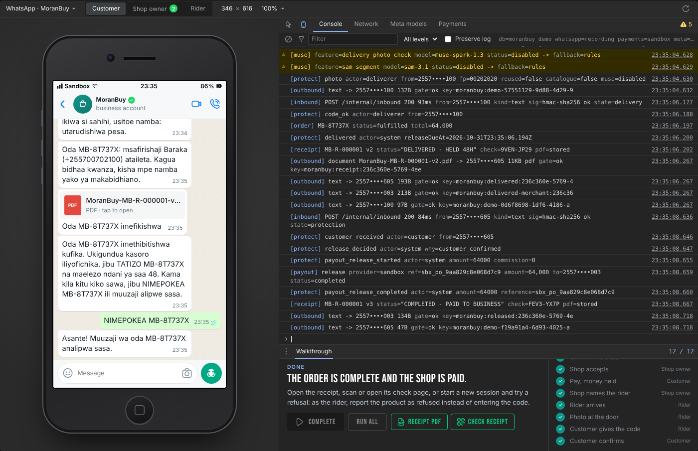

# MoranBuy

MoranBuy is an AI-powered reverse marketplace. Customers describe the product they need and the
budget they can afford. MoranBuy discovers eligible business offers and brings the most suitable
matches to the customer, prioritizing budget fit and total cost before location convenience.

> Build status: complete and tested for customers (WhatsApp and web, text, photos and voice), standalone and
> Moran-registered businesses, and administrators in Moran's Super Admin. Live services (WhatsApp, the Meta
> Model API, Snippe) run once their keys are entered; every model it calls at runtime is a Meta model; `HACKATHON_CHANGES.md` lists what is new.

## The problem

A customer in Dar es Salaam who wants a three-seater sofa for TSh 350,000 has to visit shops, message
sellers one by one, and repeat the same requirements each time. Businesses with the right product at
the right price never hear from that customer.

## The reverse-marketplace model

The customer does not browse a catalogue. The customer sends one message:

> Nina TSh 350,000 ya sofa ya watu watatu. Nipo Sinza, Dar es Salaam. Nataka delivery ikiwezekana.

MoranBuy understands the product (three-seater sofa), the maximum budget (TSh 350,000), the
location (Sinza, Dar es Salaam) and the fulfilment preference (delivery if available). It then finds
real products from eligible merchants, ranks them, and presents the best offers.

## Budget first, location second

Ranking is deterministic application code, never left to a language model:

1. **Hard constraints**: essential product requirements, quantity, currency, budget.
   `known_total_cost = product_price + known_mandatory_fees + known_delivery_cost`.
   An unknown delivery cost is recorded as unknown and disclosed, never added as zero.
2. **Budget priority**: within-budget offers before over-budget ones; lower known total cost first
   among similarly suitable offers; over-budget alternatives shown separately.
3. **Product suitability**: deterministic attribute matching against verified product data.
4. **Location priority**: among budget-competitive, suitable offers, the more convenient location
   ranks higher (distance, delivery availability, known delivery charge, pickup feasibility).
5. **Trust and availability**: verification, stock and fulfilment signals refine the order without
   hiding uncertainty.

A nearby merchant's higher price never automatically beats a substantially cheaper, suitable offer
within budget. No price, product, distance, stock level or delivery fee is ever fabricated.

## Who MoranBuy is for

- **Customers**: ask on WhatsApp or the web, get ranked offers with a cost breakdown, confirm an order explicitly.
- **Businesses**: standalone merchants register, list products and locations, and receive enquiries;
  registered Moran AI businesses link their account and their existing products appear in MoranBuy
  without re-uploading.
- **MoranBuy Admin, inside Moran AI's Super Admin** (`weare.moranai.co.tz` → MoranBuy): register
  the MoranBuy business, connect its WhatsApp number, choose its name, then merchants,
  verification, ranking evidence, consent, campaigns, follow-up, billing, Muse Spark key and
  telemetry, Snippe keys, integration health and audit logs, all with the existing Super Admin login.

## Muse Spark

MoranBuy uses Muse Spark on the Meta Model API (`https://api.meta.ai/v1`, model `muse-spark-1.3`)
to understand natural-language shopping requests in Swahili and English, interpret product photos,
extract attributes and constraints, draft recommendations from matched data, draft and revise
campaign messages, and summarise follow-up leads. Muse Spark never decides prices, budgets,
rankings, consent, authorization, payments or order state; deterministic code does. If Muse Spark
is unavailable, MoranBuy says so and uses only configured fallback behaviour.
See `docs/muse-integration.md` and `docs/muse-duties.md` (everything Muse does, with the check on each answer).

## Meta AI tooling

| Meta model | What MoranBuy does with it |
|---|---|
| Muse Spark 1.3 | Reads shopping requests and photos, writes grounded recommendations, lists products from a business's chat, picks best-fit customers, drafts campaigns and follow-ups, explains demand and admin data |
| Muse Spark 1.2 (audio) | Hears WhatsApp and browser voice notes in Swahili, English or a mix (`input_audio`, WAV) |
| Muse Voice Transcribe | Second ear for voice notes when Muse Spark audio is unavailable (`/v1/asr/transcribe`) |
| Segment Anything 3.1 | Finds every product Muse named in a business's photo; each box is cut out in-process and becomes that listing's photo, so one shelf photo lists several products |
| MMS text-to-speech (`facebook/mms-tts-swh`, `mms-tts-eng`) | Speaks the reply back as a WhatsApp voice note, in Swahili or English, run inside MoranBuy with no outside speech service |

Voice notes are decoded from Ogg Opus to 16 kHz WAV inside the Node process (`ogg-opus-decoder`, WebAssembly); nothing is
installed on the server. Spoken replies use Meta's MMS text-to-speech voices (Swahili and English), exported to ONNX when the
image is built and run in the same process; the speech is written as an Ogg Opus voice note in-process too. Every Meta call is recorded with its latency, tokens and cost.

## How it scales

- The API is stateless: run more copies behind Nginx; sessions, offers and orders live in Postgres.
- Timed work (scheduled campaigns, sending, follow-ups, reminders) runs from a Redis work list with leases; any number of workers can run, each job is claimed once, and Postgres stays the record.
- Merchants' campaigns send from each merchant's own WhatsApp number, so sending capacity grows with the merchants; the MoranBuy number only answers customers, which WhatsApp does not cap inside 24 hours.
- Muse cost is priced per request with a monthly budget and an optional hard cap; every Muse duty has a deterministic fallback, so a cap or an outage never stops answers.
- Next steps at volume: a search index for listings beyond tens of thousands of products, read replicas for statistics, and partitioning the demand-signal table by month.

## Payment protection

A WhatsApp customer pays MoranBuy, not the business, and the money is held until delivery is proven:

1. The business accepts with the full total; MoranBuy sends the customer a Snippe mobile money request.
2. Snippe's verified webhook marks the payment held. The customer gets a receipt (PDF, QR code with the signed summary) and a private six-character handover code; the business never sees it.
3. The business names its delivery person; MoranBuy sends that number three buttons: Arrived, Refused, Customer not there.
4. At the door the customer checks the product and only then gives the code. The rider sends a photo and the code: a correct code marks the order delivered. Three wrong codes lock the order for an administrator.
5. The payment goes to the business 48 hours later (or at once when the customer replies RECEIVED), unless the customer reports a hidden defect.
6. A wrong product is refused at the door with a reason and a photo; the customer confirms and is refunded, and the business gets a strike. A contested refusal or a defect becomes a dispute that only a super admin settles, with the whole evidence timeline.

Fixed rules move the money. Muse Spark and SAM 3.1 check that the delivery photo shows the ordered product and flag staged or catalogue pictures, Muse sorts the refusal reason and summarises disputes for the administrator; none of that decides anything. A photo fingerprint catches a re-sent delivery photo. "Not received" after a correct code is refused, because only the customer had the code. Receipts are re-issued as the order moves (paid, delivered, completed or refunded), and `buy.moranai.co.tz/r/<number>?c=<check>` proves one is genuine. Customers type "oda zangu" for their orders and receipts.

## Campaigns, outreach and follow-up

This repository introduces a new MoranBuy campaign engine, new-product promotional outreach and an
optional paid follow-up system. These are newly implemented MoranBuy capabilities that integrate
with existing Moran AI infrastructure where necessary; they are not presented as pre-existing
Moran AI campaign-engine features. A campaign dispatches only after consent, sender eligibility,
template approval, payment verification, rate limits and an explicit confirmation are all verified.
Follow-up is optional, activated only after the merchant explicitly accepts it.

## Existing Moran AI integration boundaries

MoranBuy keeps its own database and never reads Moran AI's. It talks to Moran AI through:

- the owner API with a linked merchant's own token (products, locations, template lifecycle);
- a signed internal channel for the admin-managed MoranBuy business (inbound customer messages
  forwarded from Moran, outbound replies through Moran's outbound gate, listings of businesses
  that opted in, admin-provided knowledge, merchant campaign sends from the merchant's own number).

MoranBuy itself is registered from Moran AI's Super Admin like any business, its WhatsApp number is
connected there with Meta's Embedded Signup, and it is managed only by administrators: Super Admin
calls MoranBuy's admin API through a signed proxy that carries the admin's identity, so there is
one login and one audit trail. Its sales agent is limited to shopping, reads only the
products of businesses that opted in, answers policy questions only from admin-written knowledge,
and can look up public shop sites through an optional Hermes research agent whose results are
always shown as "found online, not confirmed".

The Moran-side pieces are shipped from this repository under `integrations/moran-backend/` as
drop-in files for the Moran AI owner to review and apply. `docs/existing-system-assessment.md`
records what exists in Moran AI today.

## Repository layout

```
services/api/          Express API, middleware, workers, Knex migrations
packages/*             core, reverse-marketplace, budget-matching, location-ranking, muse-intelligence,
                       product-catalog, merchant-management, campaign-engine, campaign-outreach,
                       followup-engine, consent-management, billing, authorization, integrations, observability
apps/business|admin    static web apps served by the API
apps/site              public website (Home, How it works, For businesses, Try the demo, legal pages)
integrations/          Moran-side drop-ins and the Hermes research agent configuration
tests/unit|integration|security|end-to-end
docs/                  architecture, assessment, ranking, Muse, workflows, API, deployment, testing, demo
```

## Going live

`deploy/UPDATE-VPS-MORANBUY.md` puts MoranBuy on the Moran VPS as `buy.moranai.co.tz`, a separate
Compose stack talking to `https://api.moranai.co.tz`. Muse Spark, Snippe and Hermes credentials are
entered in MoranBuy Admin and take effect at once.

## Try the demo



`/demo` on the website runs the whole story on a simulated phone (customer, shop owner, rider) next to
the server log. It is served by a separate sandbox container (`moranbuy-demo`) running the same code
with `DEMO_MODE=true`: its own database, a recording WhatsApp line, the sandbox payment provider and
five sample shops on reserved numbers. It gets no production keys; the main API only passes `/api/demo`
calls through to it. Demo sessions are deleted after a day.

## Install and run

```bash
npm install
cp .env.example .env     # set DATABASE_URL, REDIS_URL, AUTH_SECRET, ENCRYPTION_KEY
npm run hooks
npm run migrate
npm run dev              # http://localhost:4000/health
```

Or `docker compose up` for Postgres, Redis, the API and the workers. The Docker image exports Meta's MMS voices itself;
to hear spoken replies outside Docker, run once `pip install -r scripts/tts/requirements.txt && python scripts/tts/export-mms-tts.py models/tts`.

## Tests

```bash
npm run lint && npm run check && npm test
npm run test:integration && npm run test:security && npm run test:e2e
```

CI (`.github/workflows/ci.yml`) runs all of these on every push against Postgres and Redis and also
rolls every migration back and forward. Results are honest: a failing check fails the build.

## Security and privacy

Secrets live only in `.env` (git-ignored, blocked by the pre-commit hook). Logs redact tokens and
phone numbers. Consent is recorded per purpose, channel and merchant, and rechecked at dispatch.
Report vulnerabilities privately as described in `SECURITY.md`.

## License and contributing

Apache License 2.0 (`LICENSE`). Existing Moran AI code remains the property of its owner and is not
relicensed here. See `CONTRIBUTING.md`, `CODE_OF_CONDUCT.md`, `SUPPORT.md` and the issue templates.

## Hackathon

Built for the Meta Global AI Developer Hackathon. `HACKATHON_CHANGES.md` lists the new work with
evidence; `docs/demo-script.md` (Phase 13) is the three-minute demo.

## Known limitations (today)

- The Moran-side changes are shipped as a patch in `integrations/moran-backend/` and are not applied to production by this repository.
- The WhatsApp provider rate for campaign pricing must be configured by an administrator; until then campaigns cannot be paid.
- Web research (Hermes) is off by default and needs an allow-list of shop domains.
- Over WhatsApp, MoranBuy answers only once the Moran-side forwarding (shipped in `integrations/moran-backend/`, Phase 10) is applied and the MoranBuy business is registered in Super Admin.
- The Meta Model API needs a key; Muse Voice Transcribe does not list Swahili among its 25 languages, so Swahili voice notes go to Muse Spark 1.2 audio first.
- Spoken replies use Meta's MMS voices, whose licence is non-commercial (CC-BY-NC 4.0): right for the hackathon and pilots; paid production use needs a commercial voice from Meta or the voices switched off.
- Live campaign and follow-up sending stays in dry-run until every gate is verified in production.
